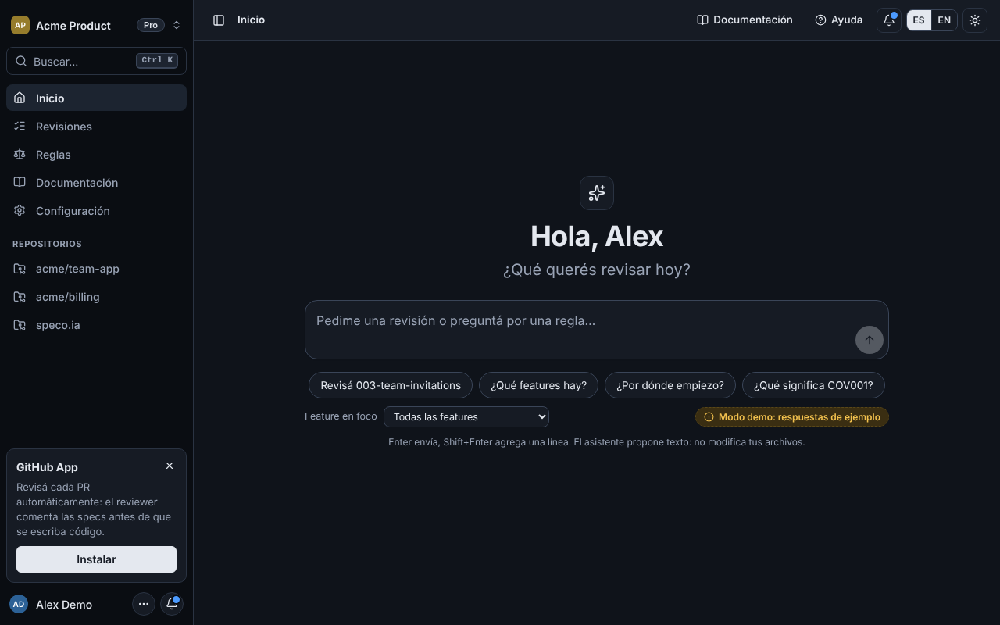
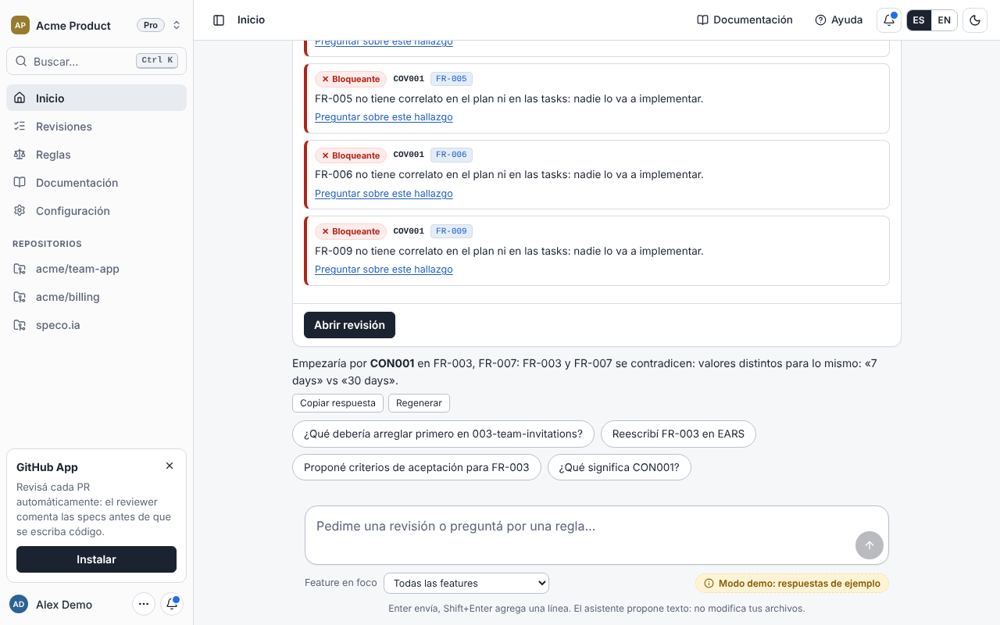
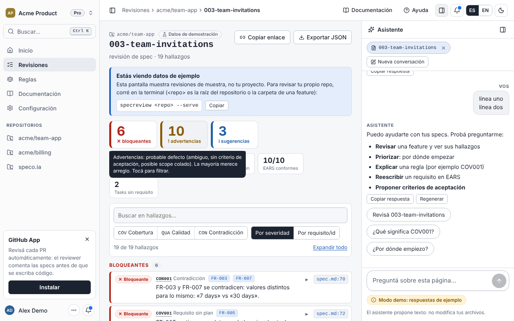

# Spec Reviewer

> **Con agentes escribiendo el código, lo caro es decidir qué construir y mantenerlo coherente.** Speco es la capa donde esa decisión vive, se revisa y se verifica: el Cursor para el negocio, para gerencia y producto. Tesis completa: [`docs/16-thesis.md`](docs/16-thesis.md).

Code review para specs de [GitHub Spec Kit](https://github.com/github/spec-kit), **antes** de escribir código.
Lee `spec.md`, `plan.md` y `tasks.md` y responde:

| Pregunta | Reglas |
|---|---|
| ¿Qué requisitos no tienen correlato en el plan/tasks? | `COV001`, `COV004`, `COV006` |
| ¿Qué pasos del plan o tasks no responden a ningún requisito (scope colado)? | `COV002`, `COV003` |
| ¿Qué requisitos son ambiguos o no testeables? (EARS como vara) | `QUA001`-`QUA003`, `QUA007` |
| ¿Qué criterios de aceptación faltan? | `QUA005`, `QUA006`, `QUA008` |
| ¿Hay requisitos contradictorios? | `CON001` (determinista), `CON002` (modelo) |
| ¿Responde a un objetivo y respeta lo ya decidido? (opt-in, carpeta `product/`) | `PRD001`-`PRD005` |

## Empezá en 5 minutos (desarrolladores)
```bash
uvx --from git+https://github.com/agustindelmonti/speco.ia specreview demo     # tu primer hallazgo: sin clonar, sin repo propio, sin API key
claude mcp add specreview -- uvx --from git+https://github.com/agustindelmonti/speco.ia specreview mcp .   # el MCP en tu agente
```
Guía paso a paso (Claude Code, Cursor, VS Code, Claude Desktop, Codex, CI): [`docs/28-developer-quickstart.md`](docs/28-developer-quickstart.md).
Qué podés lograr, con casos reales: [`docs/29-developer-recipes.md`](docs/29-developer-recipes.md). En la app: **Ayuda → Para desarrolladores** (`/docs/developers`).

**¿Producto, gerencia o founder?** Cómo se instala en tu flujo con agentes en paralelo y qué cambia en tu día: [`docs/30-product-manager-guide.md`](docs/30-product-manager-guide.md).
Posicionamiento, pitch y qué se puede afirmar en público: [`company/`](company/README.md).

## La aplicación

Una app **agent-first**: la página de inicio es un chat vacío ("¿Qué espera tu decisión hoy?") y en el resto de las páginas el agente
vive en un panel lateral colapsable (`Ctrl/Cmd+J`). Alrededor, un shell de producto: sidebar, selector de workspace, buscador con
paleta de comandos (`Ctrl/Cmd+K`), notificaciones, idioma ES/EN, tema claro/oscuro, ayuda y documentación integradas, y páginas de
configuración de ejemplo (miembros, API keys, integraciones, uso).

| Inicio: chat vacío | Tarjeta de revisión en el chat | El agente en el panel de cualquier página |
|---|---|---|
|  |  |  |

- **Cloud (producción):** <https://speco-app.vercel.app>, con login, empresas reales y la GitHub App. Despliegue y estado: [`docs/35-cloud-deploy.md`](docs/35-cloud-deploy.md).
- **Demo (sin backend):** se compila cuando faltan las variables `VITE_*`; el agente es una simulación en el navegador con datos reales de las specs de
  ejemplo y del propio producto. Sesión, workspaces, miembros, facturación y notificaciones son **simulados** y rotulados como demo.
  Cómo desplegarla en Vercel: [`docs/09-deploy-vercel.md`](docs/09-deploy-vercel.md).
- **Con tu repo (servidor local):** `specreview <repo> --serve` sirve la app con tus specs; con `--llm anthropic` el agente usa un
  modelo real.

## Uso
```bash
pip install -e '.[dev]'
specreview examples/invitations                 # un hallazgo por línea, con severidad y ubicación
specreview <repo> -v                            # + arreglo sugerido y evidencia
specreview <repo> --all                         # todas las features de specs/ + tabla resumen
specreview <repo> -f json | -f markdown         # para máquinas / comentario de PR
specreview <repo> --min-severity warning        # ocultar sugerencias
specreview <repo> --fail-on warning             # exit code 1 desde esa severidad (CI)
specreview --explain COV001                     # qué significa una regla (--rules las lista)
specreview <repo> --serve                       # la app en http://127.0.0.1:8765 (compilar web/ antes)
specreview <repo> --serve --llm anthropic       # agente con modelo real (requiere ANTHROPIC_API_KEY)
specreview <repo> --serve --llm anthropic --models claude-haiku-5-5,claude-sonnet-5-5,claude-opus-5-5   # + elegir modelo y esfuerzo en el chat
specreview <repo> --serve --llm demo            # agente con respuestas de ejemplo desde el servidor
specreview <repo> --llm anthropic               # juez opcional del análisis por terminal
specreview <repo> -f html -o review.html        # reporte autocontenido (requiere `npm run build:single` en web/)
```
`<repo>` puede ser la carpeta de la feature (`specs/003-x`) o la raíz del repo. Exit codes: 0 ok, 1 hallazgos sobre el umbral, 2 error.

### En CI y adopción
```bash
specreview init                      # specreview.toml + workflow de GitHub Actions
specreview baseline                  # registrar la deuda actual: de ahora en más sólo lo nuevo
specreview waive <fingerprint> --reason "lo decidió producto"
specreview . --diff origin/main -f sarif -o specreview.sarif      # sólo features del PR, anotaciones en el diff
specreview diff origin/main          # qué cambia en el negocio respecto de main (el comentario de la GitHub App, docs/32)
specreview verification             # qué requisitos cita algún test o propiedad (`# verifies[property]: 010/FR-003`, docs/37)
```
Detalle en [`docs/10-adoption.md`](docs/10-adoption.md).

### El qué: qué hace hoy el software y cómo lo sabemos
```bash
specreview ledger .                         # cada regla: propuesta, decidida, construida sin test, con test, verificada o rota
specreview ledger . --today                 # sólo lo que el software hace hoy
specreview ledger . --verify 028/FR-002     # corre los tests que citan esa regla y registra el resultado (encadenado)
specreview ledger . --history 028/FR-002    # cada versión de la regla en git, quién la aprobó y cada verificación
```
Un test cita la regla que comprueba como `028/FR-002`. Para un agente: `what_it_does`, `draft_feature`, `change_requirement`, `verify_intent` e
`intent_history` por MCP; en la app, **El qué** (`/ledger`). Ver [`docs/39-intent-ledger.md`](docs/39-intent-ledger.md).

### Para agentes de código (MCP y plugin)
```bash
specreview mcp .                     # servidor MCP por stdio: what_it_does, get_blockers, draft_feature, change_requirement, ...
# Claude Code: /plugin marketplace add agustindelmonti/speco.ia  ->  /plugin install specreview@specreview
```
El agente revisa la spec antes de implementar y `/speckit.implement` se frena si hay bloqueantes. Ver [`docs/11-mcp-and-plugin.md`](docs/11-mcp-and-plugin.md).

### Aprobaciones, Slack y Jira
```bash
specreview member add "Ana" --role approver      # token (una vez); luego `specreview . --serve` y decidir desde la app
specreview approvals list | verify               # registro con hashes encadenados en .specreview/approvals.jsonl
specreview notify slack . --interactive          # digest de lo que espera tu decisión, con botones
specreview jira sync --project PROJ              # epics e issues como contexto de producto (PRD006)
```
Ver [`docs/14-approvals-and-connectors.md`](docs/14-approvals-and-connectors.md).

### Compilar y probar la interfaz
```bash
cd web && npm ci && npm run build            # app + demo para Vercel
node scripts/verify-shell.mjs                # 600+ chequeos en un navegador real, imitando las reglas de Vercel
node scripts/verify-developers.mjs           # la página de onboarding para desarrolladores (/docs/developers)
node scripts/test-demo-agent.mjs             # el agente simulado contra los reportes reales
python scripts/gen_samples.py                # regenerar los datos de la demo (un test vigila que estén al día)
```

## Cómo funciona (y sus límites)
Parser → modelo normalizado → analizadores registrables → `Report` (texto / JSON / Markdown / HTML).
Todo es **determinista y offline** por defecto; el modelo (`--llm`) es una capa opcional y reemplazable (`llm.LLMClient`, una función).
La trazabilidad requisito↔plan se infiere por texto porque Spec Kit no la trae; por eso un hueco inferido sólo por texto es
advertencia, y bloquea únicamente con trazabilidad explícita (`FR-###` citado) o confirmación del modelo.
**Leé `docs/04-real-repo-calibration.md` antes de confiar en los números**: sin `--llm` la precisión sobre prosa real es limitada.

## Documentación
`docs/01` estructura de Spec Kit · `02` plan · `03` decisiones · `04` calibración con repo real · `05` contrato de la UI · `06` contrato del asistente · `07` guía del producto · `08` dogfooding · `09` despliegue en Vercel · `10` adopción (CI, baseline, SARIF) · `11` MCP y plugin · `12` decisiones (app para quien aprueba) · `13` capa de producto · `14` aprobaciones, Slack y Jira · `15` simple por defecto · `28` quickstart para desarrolladores (CLI + MCP) · `29` recetas: qué lograr con la CLI y el MCP · `30` guía para producto: cómo Speco se mete en un flujo con agentes en paralelo · `32` la GitHub App que comenta las PRs · `33` del QR al primer resultado · `34` Spec Kit, sus hooks y `/speckit-analyze` frente a Speco · `35` la versión cloud en Vercel · `36` workflows de Spec Kit · `38` el circuito de decisión en la nube y la segunda puerta · `39` el qué: registro de intención · `specs/` las specs propias (dogfooding).

## Tests
`pytest` (incluye verdad conocida sobre `examples/invitations/expected.json`).
